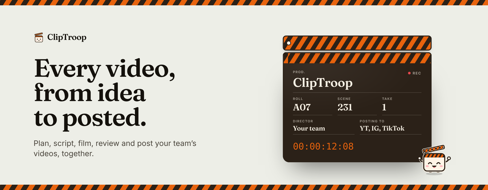
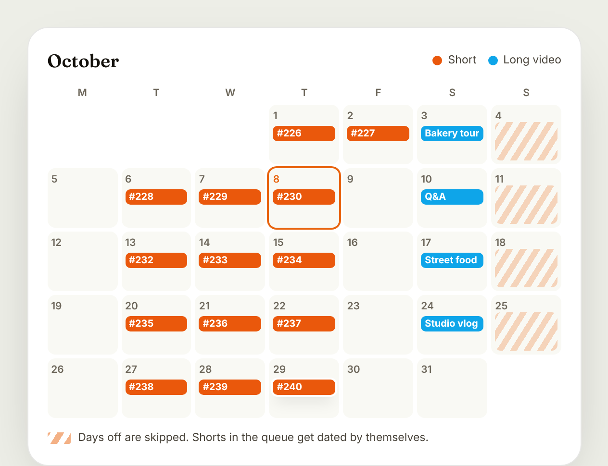
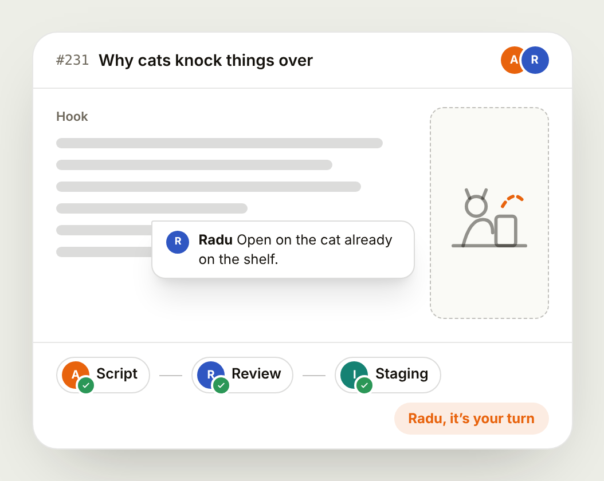
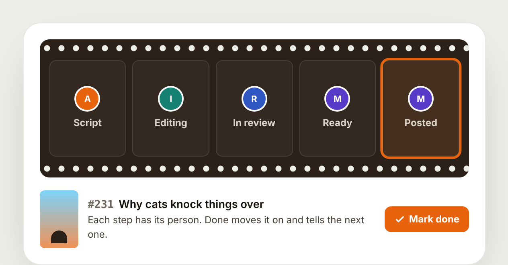
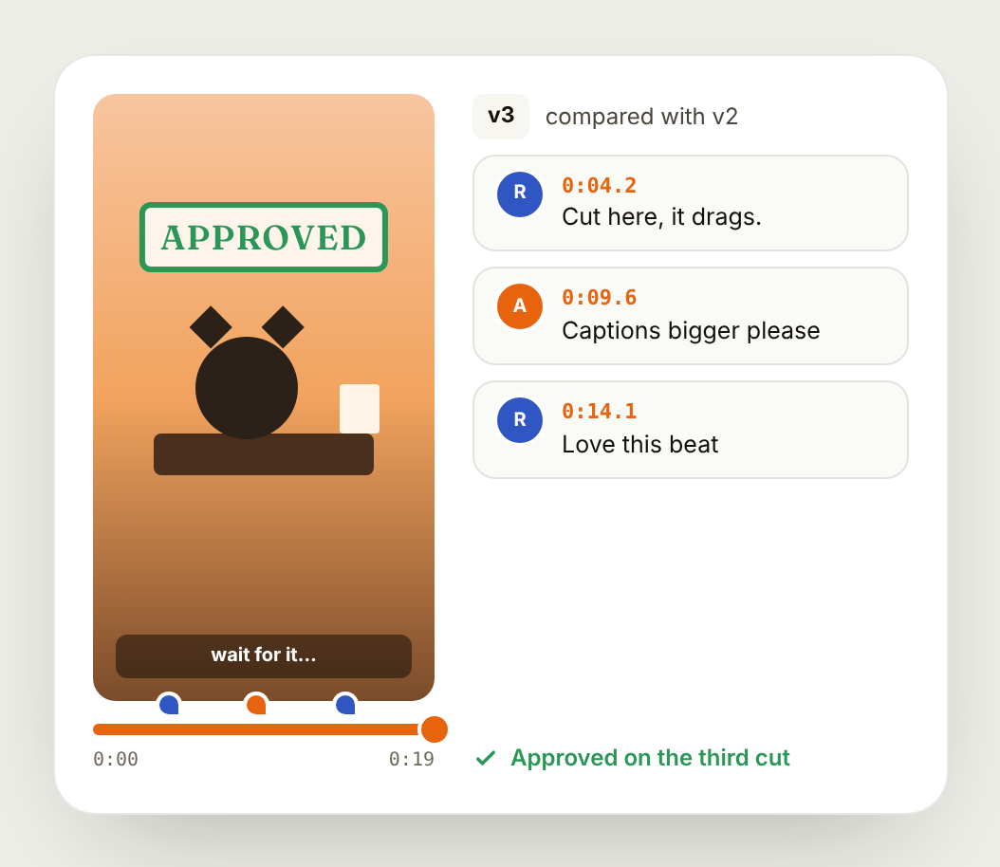
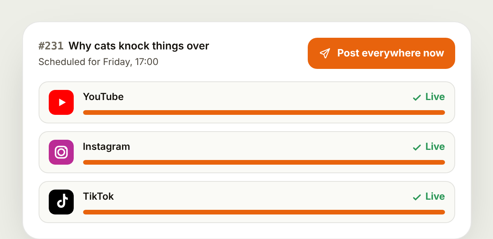
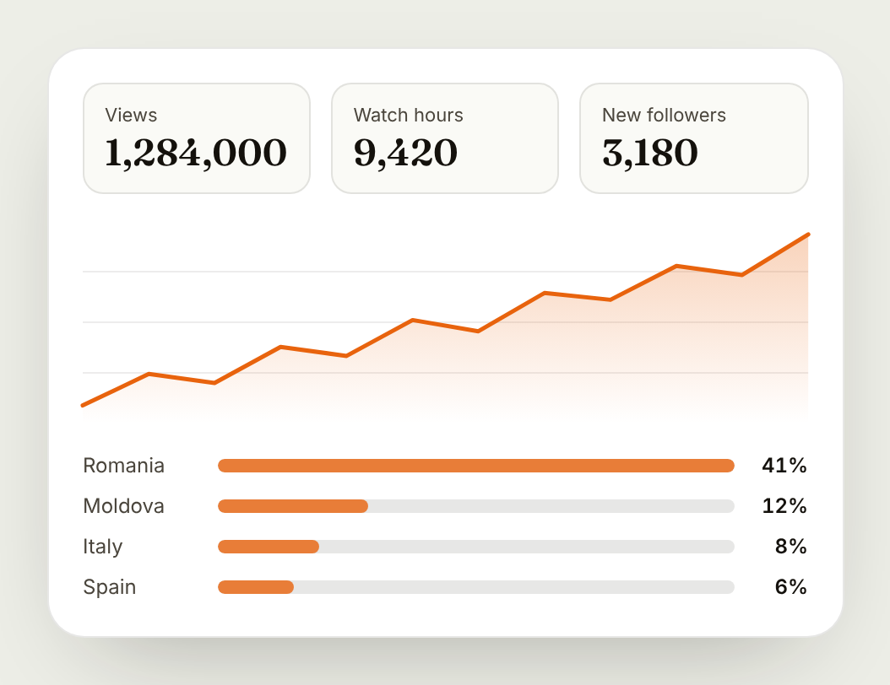

<picture>
  <source media="(prefers-color-scheme: dark)" srcset="docs/readme/banner-dark.png">
  
</picture>

<p align="center">
  The studio where a video team plans, scripts, films, edits, reviews and posts,<br>
  so everyone sees what's next and whose turn it is.
</p>

<p align="center">
  <a href="https://app.cliptroop.com"><b>app.cliptroop.com</b></a>
  &nbsp;&nbsp;·&nbsp;&nbsp;
  <a href="https://staging.cliptroop.com">staging</a>
  &nbsp;&nbsp;·&nbsp;&nbsp;
  <a href="https://app.cliptroop.com/status">status</a>
</p>

<p align="center">
  
  
  
  
  
</p>

<br>

## One video, start to finish

Six scenes, the way video teams already work. Each person sees their part,
and the next person knows the moment it's their turn.

<br>

*Scene 1*

### Ideas become a schedule

Drop shorts into the queue and they're given a day by themselves, a few at a
time, around your days off. Pin the ones that have to go out on a date. Long
videos keep their own deadline.

<picture>
  <source media="(prefers-color-scheme: dark)" srcset="docs/readme/scene-plan-dark.png">
  
</picture>

*Scene 2*

### Write it, then hand it on

Write the script together, comment on any line and sketch editing ideas right
next to it. When it's ready, send it to review and then to staging. The next
person is told it's their turn.

<picture>
  <source media="(prefers-color-scheme: dark)" srcset="docs/readme/scene-script-dark.png">
  
</picture>

*Scene 3*

### Everyone knows whose turn it is

Every short and long video moves through the same steps, with a person on
each one. Mark your part done and it moves on, and the editor, reviewer or
scheduler hears about it at the right moment.

<picture>
  <source media="(prefers-color-scheme: dark)" srcset="docs/readme/scene-make-dark.png">
  
</picture>

*Scene 4*

### Notes on the exact frame

Upload a cut and the team watches it right in the browser. Pin a note to the
second it's about, reply, upload the next version and compare. Approve it
when it's right.

<picture>
  <source media="(prefers-color-scheme: dark)" srcset="docs/readme/scene-review-dark.png">
  
</picture>

*Scene 5*

### Out everywhere, on time

Schedule each approved short for YouTube, Instagram, Facebook and TikTok from
your team's own accounts, or post it everywhere right now. Every step is visible,
and anything that goes wrong is explained, with a retry.

<picture>
  <source media="(prefers-color-scheme: dark)" srcset="docs/readme/scene-post-dark.png">
  
</picture>

*Scene 6*

### See what worked

Analytics in tabs, like YouTube Studio. The Overview puts the numbers that
matter (views, watch time, followers, engagement, impressions, CTR, revenue)
on cards that switch one powerful chart: every platform together or side by
side, YouTube's Shorts next to its long videos, from the last 48 hours hour
by hour to your channel's whole history since its first day, with the videos
posted on each day marked. Beside it, what's happening right now. Realtime
shows every video's counts within minutes (the last 48 hours or the last
hour), Audience who's watching and where, Content every video with its
numbers, Revenue which videos made each day's money, and Insights every hint
in one place, each with examples from your own videos: what changed lately,
what works and the best time to post. Advanced has every number the
platforms share in its own tabs, and every video has its own page with
YouTube Studio's tabs (Overview, Reach, Engagement, Audience, Revenue): how
it did next to your typical one, where its views came from, who watched,
and its views right now.

<picture>
  <source media="(prefers-color-scheme: dark)" srcset="docs/readme/scene-measure-dark.png">
  
</picture>

<br>

## Also starring

- **Outliers**: Videos in your niche doing far better than their own channel's usual, the formats, keywords, titles and thumbnails behind them, and ideas for your next videos made from them (no AI), with alerts when a tracked channel's video takes off. A niche is the channels you pick and the ones its keywords find that fit (language, where they're from, what they post); the channels your viewers also watch; hide any channel for good.
- **Your turn, on your phone**: Install it from the browser on iPhone or Android and get a notification when it's your turn. No app store.
- **Clip**: The clapperboard who shows new people around, cheers when things are done and keeps you company while pages load.
- **Meetings**: Agenda, notes and action items that land in each person's tasks.
- **Objectives**: The team's goals (shorts a week, Instagram-only reels, long videos a month, views) fill up live, and everyone gets confetti when one is reached. A win streak counts the days (or weeks) in a row with a goal reached.
- **Projections**: Long-term targets with a date (200K subscribers by December, a Reels skip rate under 22% by spring), kept every morning with the pace it needs, where it lands and a Compare of then and now.
- **Download for Claude**: Your numbers, hooks, thumbnails and opening frames in a text file and a PDF to drop into a chat with Claude (the free plan works) and ask what works.
- **Your dashboard**: Widgets you arrange, from today's tasks and the calendar to what's posting, the numbers and the team's goals.
- **Thumbnail studio**: Thumbnail ideas side by side, so the team can pick the winner.
- **Search**: Any video (with its numbers), script or person, from anywhere.
- **Status**: A public page that shows whether everything is running, hour by hour.

<br>

## Under the hood

- **App**: Next.js 15 (App Router) and React 19, styled with Tailwind. One codebase for pages and server actions.
- **Data**: Supabase, with Postgres (row-level security on every table), Auth, Storage and Realtime.
- **Clockwork**: Supabase's own timer (pg_cron) runs the posting queue every minute, the status check and every video's counts every 10 minutes, Outliers' collector every 30 minutes, and two daily jobs.
- **Hosting**: Vercel. `staging` deploys to staging.cliptroop.com, `main` to app.cliptroop.com.
- **Posting**: The official YouTube, Instagram, Facebook and TikTok APIs, through each team's own accounts.
- **Outliers**: Public videos read with YouTube API Services within a daily budget, refreshed or deleted within 30 days; the scores, formats, keywords and ideas are worked out by pure TypeScript that runs on the server and in the browser.
- **Quality**: Every push runs type checks, lint, tests, a production build and every database migration from scratch.

```text
app/          pages and routes (the app, the public pages, the API)
components/   shared interface pieces
modules/      each feature's own parts (shorts, long videos, scripts, review…)
lib/          helpers shared across features
supabase/     database migrations, applied in order
scripts/      database tooling and a stand-in backend for local previews
```

### Running it locally

```bash
npm install
cp .env.example .env.local   # fill in the staging project's values
npm run dev                  # http://localhost:3000
```

There's no public sign-up: accounts come from a team owner's invite.

### Shipping

1. Push to `staging`. CI runs and the database migrations go to staging first.
2. Check it on staging.cliptroop.com.
3. Open a pull request from `staging` to `main` and merge it with a merge commit.

### More reading

- [`docs/DEVELOPMENT.md`](docs/DEVELOPMENT.md): how features are built here (security, timers, performance, UI rules).
- [`VPLANNER_HANDOFF.md`](VPLANNER_HANDOFF.md): the full history, every migration and release.
- In the app, **What's new** has the release notes.

<br>

<p align="center">
  <br>
  <sub>© 2026 ClipTroop. Private and proprietary: not open source, all rights reserved.</sub>
</p>
